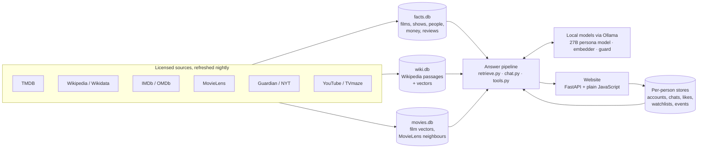
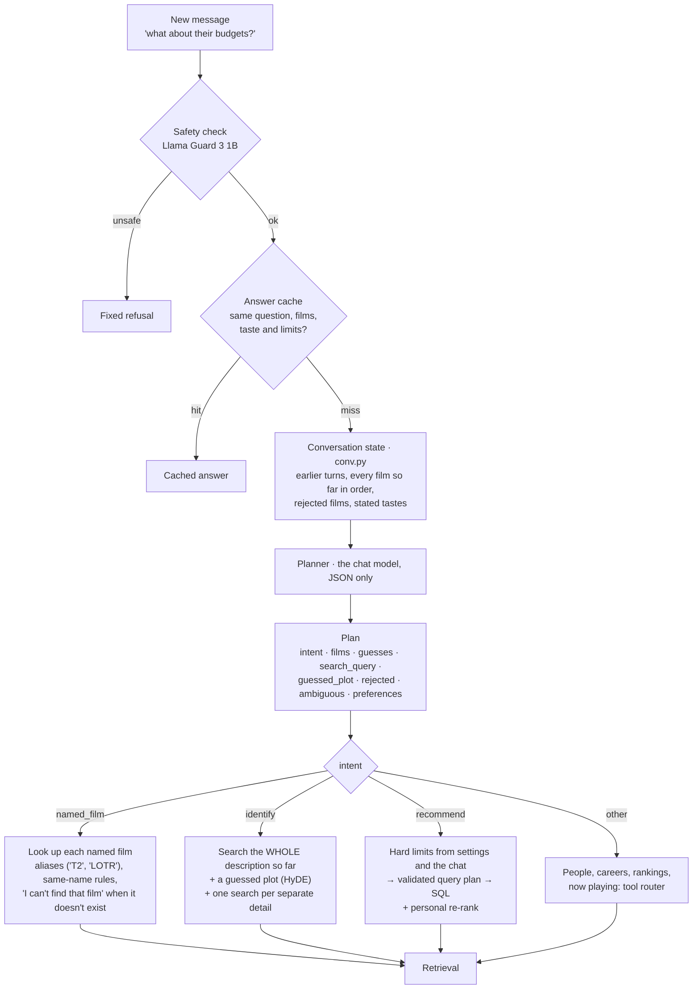
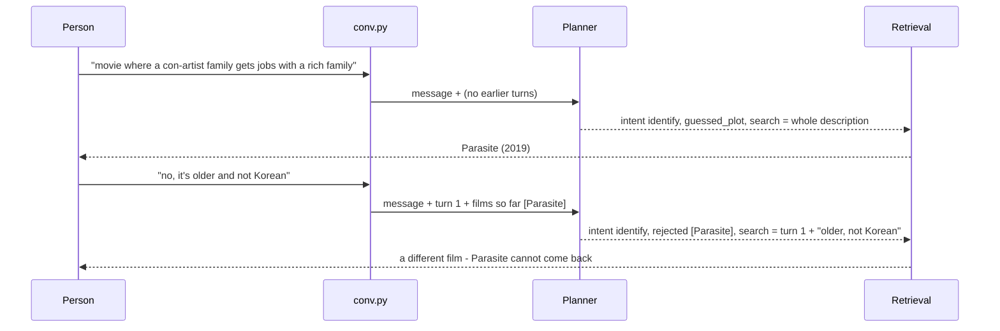
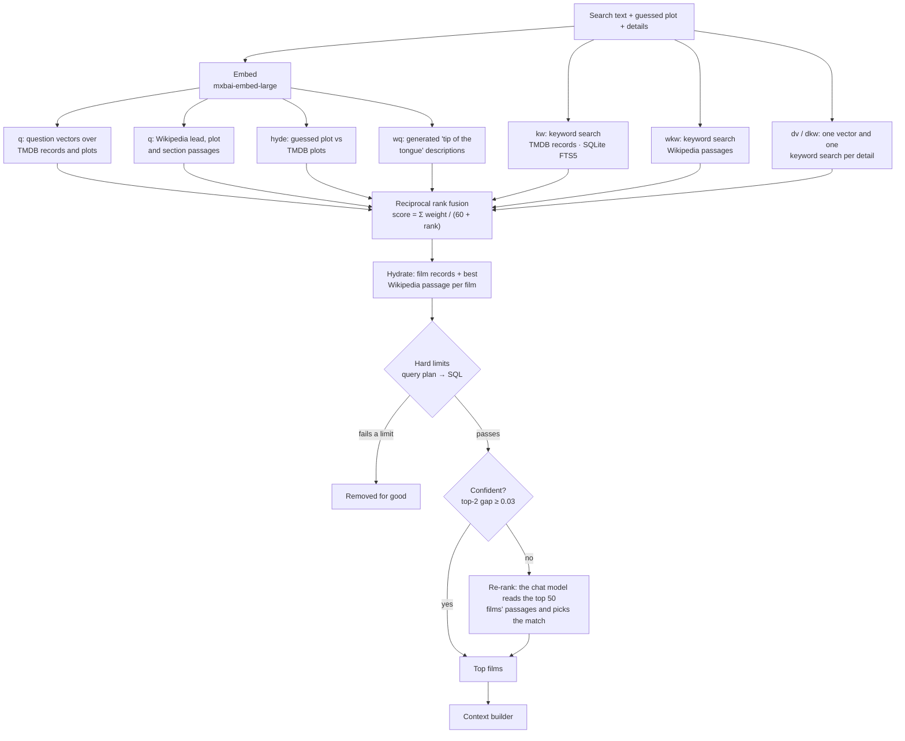
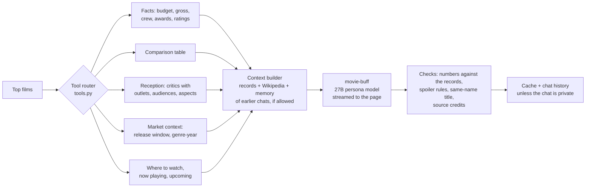
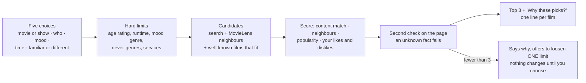
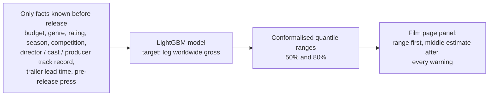
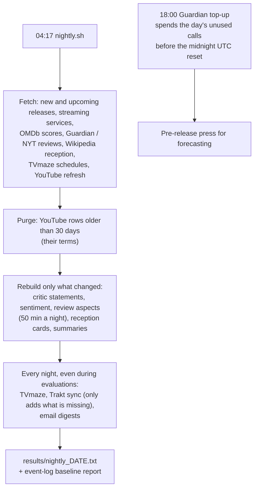
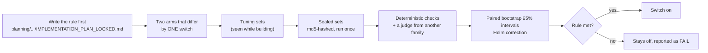
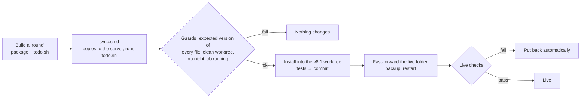

# Cinemack

**A film and TV assistant that runs on one university GPU with open models.** It answers questions about films and
shows, finds a film from a half-remembered description ("the one where a family of con artists gets jobs with a rich
family"), recommends films within a person's hard limits, explains its picks, and forecasts box office with honest
ranges. Code name in the source: *Movie Buff*.

It was built so that **every claim about it can be checked**: each feature sits behind its own switch, the rule for
keeping a feature is written down before it is tested, and the failures are reported next to the successes.

> **Start here:** this README is the overview, with diagrams. For more detail, read [`docs/guide/`](docs/guide/README.md)
> in order. To see how the project was built, read [`docs/HISTORY.md`](docs/HISTORY.md) (every commit) and
> [`docs/BUILD_NOTES.md`](docs/BUILD_NOTES.md) (versions 3 to 7).

## Contents

1. [Versions and branches](#versions-and-branches)
2. [What it does](#what-it-does)
3. [The system in one picture](#the-system-in-one-picture)
4. [How a chat becomes searches](#how-a-chat-becomes-searches)
5. [How retrieval works](#how-retrieval-works)
6. [How the answer is written and checked](#how-the-answer-is-written-and-checked)
7. [Recommendations and Pick Tonight](#recommendations-and-pick-tonight)
8. [Box-office forecasting](#box-office-forecasting)
9. [The data and the nightly refresh](#the-data-and-the-nightly-refresh)
10. [The website and its switches](#the-website-and-its-switches)
11. [How it is tested](#how-it-is-tested)
12. [How changes reach the server](#how-changes-reach-the-server)
13. [Running it](#running-it)
14. [Repository map](#repository-map)
15. [Data and licences](#data-and-licences)

## Versions and branches

`main` is the **current best working version**: the newest code that passed every test. Each earlier version has its
own branch at the point it was locked, so any version can be checked out and compared.

| Branch | Dates (2026) | What that version is |
| --- | --- | --- |
| **`main`** | now | **v8.1 as it runs today**: everything below, plus the round-55 fixes (20 Nov) |
| `v8.1` | 12-20 Nov | One id per title, hard limits compiled to SQL, box-office forecast panel, follow people, anonymous event log, Guardian articles on film pages, news in search, the nightly Trakt sync |
| `v8` | 6-12 Nov | Locked at the sealed v8 test. The **Cinemack** redesign (home, Pick Tonight, calendar, watchlist, profile), same-name and invented-title honesty, memory of earlier chats, filters per chat |
| `v7` | 23 Oct-5 Nov | Critic reception from Wikipedia citations, TV shows and episodes, people, safety guard, fast paths and caches, a licence register |
| `v6` | 16-22 Oct | The site as a product: accounts, onboarding, settings, memory notes, posters, more free data (OMDb, Guardian, NYT, YouTube, Netflix, MovieLens) |
| `v5` | 14-16 Oct | Why a film succeeded: a box-office model with release context, budgets and grosses in every currency, critic scores, nicknames ("T2"), about 2,000 recent films added, news at release, the first nightly model-adapter rebuild (includes the v4 work) |
| `v3` | late Sep-14 Oct | Conversation-aware planner, tools for facts, comparisons and careers, personal re-ranking |
| `v2` | late Sep | The tip-of-the-tongue pipeline: Wikipedia passages, HyDE, fusion, re-ranker |
| `v1` | 23 Sep | The baseline: TMDB records only |

There is no `v4` branch: the v4 work (contextual chunks, filtering liked answers, nightly adapter rebuilds, news at
release) is in the `v5` branch's history. See [`docs/BUILD_NOTES.md`](docs/BUILD_NOTES.md).

## What it does

- **Answers about any film or show:** facts, cast and crew, money, reception, where to watch, "why did it do well",
  side-by-side comparisons. Answers are written from stored records, and the sources are credited.
- **Identifies a film from a vague description**, including follow-ups like "no, it's older and Korean".
- **Recommends within hard limits:** age rating, length, years, genres to avoid, and "only my streaming services".
  These are enforced in code before the model sees any film.
- **Pick Tonight:** five quick choices give three ranked films or shows, each with a short reason.
- **Release calendar, watchlist, alerts and email digests, TV progress, friends, Trakt import.**
- **Box-office forecasts:** a range first, a middle estimate after it, and every warning.
- **News and reviews:** Guardian and New York Times articles under search results and on film pages.

## The system in one picture



**The key design choice:** code decides which films may be discussed, and the language model only writes once that
decision has been made. A film that breaks a person's limit is removed before the model sees it, so it can never be
recommended "by accident".

## How a chat becomes searches

A chat message is never searched as it is. A **planner** reads it together with the conversation so far and writes
a small structured plan. The rest of the pipeline follows that plan.



**What the planner writes.** Here is a real example from the planner's own instructions. It is the third turn of a
chat that started with *"Why did Oppenheimer do so well?"* and continued with *"Compare that with Barbie."*:

```json
{"intent": "named_film",
 "films": [{"title": "Oppenheimer", "year": 2023}, {"title": "Barbie", "year": 2023}],
 "guesses": [],
 "search_query": "Compare the production budgets of Oppenheimer (2023) and Barbie (2023)",
 "guessed_plot": "", "rejected": [], "ambiguous": false, "preferences": []}
```

- **`search_query`** is the message rewritten to make sense on its own: "their" becomes both titles.
- **`films`** holds what the message refers to, earlier films first. "It", "the first one" and "the one from
  earlier" are resolved from the conversation state, not from the words alone.
- **`rejected`:** "no, that's not it" puts the last answer's film here, so it is never offered again, and the
  description search uses everything said about the film so far.
- **`guessed_plot`** (descriptions only): two or three sentences written the way a film database would summarise
  the plot. Searching with it finds films whose summaries *read* like that (HyDE).
- **`preferences`** are lasting tastes ("I hate jump scares"). They go to the person's profile, not just this chat.
- **`ambiguous`** is set when "it" could fairly mean two films. Both are kept, most likely first.

A description with several separate details ("a boarding school… a ghost in the library… it happens in one night")
is also **split into its details**. Each detail is searched on its own and the lists are fused, so one strong detail
cannot be drowned out by the rest.



## How retrieval works

Retrieval turns the plan into a short list of films. It runs several different searches at once and merges their
rankings.



- **Why several searches?** Each one fails differently. Vectors find meaning ("a man relives one day"), keywords find
  rare exact words ("Bill Murray", "groundhog"), Wikipedia catches scenes that TMDB summaries leave out, and the
  generated descriptions match the vague way people remember films.
- **Why reciprocal rank fusion?** It merges rankings using positions only (k = 60), so scores from very different
  searches never need calibrating against each other. Per-list weights are set by `RRF_WEIGHTS`.
- **In-memory vectors.** The vectors are cached in memory (`vec_cache/`), which gives the same results as sqlite-vec
  about 7 times faster. `mb.py check` refuses to run if the embedder differs from the one that built the vectors.
- **The re-ranker only runs when needed.** When the top two results are far apart, the re-ranker is skipped. This
  saved it on about a third of tuning questions without losing a single correct answer.
- **Hard limits are not suggestions.** Saved settings and limits stated in the chat ("nothing scary, under two
  hours, on Netflix") become a validated query plan (schema 1.1) compiled to parameterised SQL. On all 33,041 films
  and 8,043 shows it matches a plain-Python reference **100%** of the time. In strict mode an unknown fact fails the
  limit.

## How the answer is written and checked



| Model | Job | Why this one |
| --- | --- | --- |
| `movie-buff` (LoRA on a 27B Qwen model) | Planning, re-ranking, answers | A consistent persona; runs locally |
| `mxbai-embed-large` | Every vector | One embedder for everything, checked at start-up |
| `llama-guard3:1b` | Safety | Small and fast |
| `llama3.2` | Generated descriptions, review aspects, small jobs | Cheap for bulk work at night |
| `gemma3:27b` | Evaluation judge only | A different model family, so the system is not graded by its own kind |

## Recommendations and Pick Tonight



- **Films** go through the normal pipeline with strict filters. **Shows** are ranked in code from IMDb ratings
  weighted by votes, with no model call.
- **The "why"** for each pick appears once, at the bottom, in one line per film. It uses only sentences that name
  that film and no other. If the answer has no such sentence, it is built from what is known about the film (genre,
  length, service, rating).
- **A better ranking failed three tests (14-16 Nov), so the current ranking stays.** Against random films,
  "people who liked X" and popularity look strong. Against popular films, they are weak or useless. No single set of
  weights won on both tests. The next try is measured on real use: a pre-registered two-week baseline from the
  anonymous event log (20 Nov to 4 Dec), described in [RECOMMENDATIONS.md](docs/guide/RECOMMENDATIONS.md).

## Box-office forecasting



- **Leak-proof inputs.** Every input carries an "as of" date. Anything learned after release, such as audience
  votes, reviews or opening weekend, is excluded from the before-release model.
- **Results on 2016-2019 films:** the 80% range held 77-79% of the time and the 50% range 47-48%. The typical miss
  is about 3x either way, and the ranges are wide (about x35). For 2020-2023, after the streaming shift, the model
  over-predicts and its ranges hold less often. The panel says so. Details: [BOX_OFFICE.md](docs/guide/BOX_OFFICE.md).

## The data and the nightly refresh



| Store | Holds |
| --- | --- |
| `facts.db` | 33,041 films and 8,043 shows with seasons and episodes; people and credits; keywords; age ratings; streaming services; budgets and grosses; awards; IMDb ratings; critic reviews; trailers |
| `wiki.db` | Wikipedia lead, plot, production, reception and box-office passages, with vectors and a keyword index |
| `movies.db` | Film vectors, generated descriptions, MovieLens neighbours |
| `logs/*.db` | Per-person data: accounts, chats, likes, watchlists, follows, email settings, Trakt links, anonymous events |

**One id per title.** A TMDB number is not unique: 1,072 numbers belong to both a film and a show. Every title gets
one id, `movie:<tmdb>` or `tv:<tmdb>`, and 125,484 outside ids (IMDb, Wikidata, TVDB) are each rated `ok`, `stale`,
`wrong_type` or `shared`.

## The website and its switches

One Python server (`web/server.py`, FastAPI) and plain-JavaScript pages (`web/v8/`), with no build step. The pages
are home, chat, film and show pages, Pick Tonight, Release Calendar, watchlist, profile and settings, and friends.
`MOVIE_BUFF_MOCK=1` runs the whole site with a fake model and sample data, so it can be tested without a GPU.

Every v8.1 feature has its own switch. A route whose switch is off answers 404, exactly as if it did not exist.

| Switch | What it adds | State |
| --- | --- | --- |
| `FORECAST_PANEL` | Box-office forecast on the film page | on |
| `FOLLOW_PEOPLE` | Follow an actor or director | on |
| `REC_EVENTS` | Anonymous "shown / opened / saved" events, for testing rankings (no account id, no text) | on |
| `GUARDIAN_LIVE` | "In the Guardian" on film pages: stored first, at most 20 live lookups a day | on |
| `SEARCH_NEWS` | Stored news and reviews under search results, with no API call | on with round 55 |
| `RECS_V2` | The new ranking | off: failed its tests |
| `QUERY_PLAN_SHADOW` | Logs where the new query plan and the older filter path disagree | off: not connected yet |
| `TOOL_ROUTER` | Four typed tools the chat model may call | off: needs a GPU test |
| `DEALS` | Rental and purchase prices (Watchmode pilot) | off: being built |

Switches for answers are listed in `v7_lock.env` and `v8_lock.env`, and the website-only ones in `site.env`.

## How it is tested



| Sealed v8 test (12 Nov), v7 → v8 | v7 | v8 |
| --- | --- | --- |
| Same-name titles: right title named first (of 15) | 11 | 13 |
| Invented films presented as real (of 10, lower is better) | 1 | 0 |
| Memory: refer-backs recalled correctly (of 16) | 12 | 15 |

There are 46 unit-test modules (`tests/`) plus page-module tests run with Node (`tests/js/`). Every result, including
every failure, is in [EVALUATION_AND_RESULTS.md](docs/guide/EVALUATION_AND_RESULTS.md).

## How changes reach the server



The live site runs from its own folder. New work is built in a separate worktree (branch `v8.1`) and reaches the live
folder only by fast-forward, after the tests pass. Every round can be run again safely: a second run only collects
results.

## Running it

```bash
python3 -m venv ~/venvs/movie-rag && source ~/venvs/movie-rag/bin/activate
pip install -r requirements.txt
ollama pull mxbai-embed-large && ollama pull llama3.2      # + the movie-buff model, or set ANSWER_MODEL
python mb.py check           # every line should say ok
python mb.py build           # the data build steps, with status and commands (needs your own API keys)
python mb.py build-cache     # in-memory vectors
python mb.py ask "that movie where a guy relives the same day over and over"
MOVIE_BUFF_CODE=pick-a-code python mb.py serve              # the website on port 49151
MOVIE_BUFF_MOCK=1 python web/server.py                      # the website with a fake model, no GPU
```

**Hardware:** a 24 GB GPU for the 27B model (about 17 GB). With less memory, set `ANSWER_MODEL` to a smaller Ollama
model. **Data:** none is included in this repository. Fetch your own copy under each source's terms; see
[REPRODUCE.md](docs/guide/REPRODUCE.md) and [DATA_SOURCES.md](DATA_SOURCES.md).

| Command | Does |
| --- | --- |
| `python mb.py check` | Packages, Ollama and models, databases, embedder match, vector cache, GPU. Exit 1 on any FAIL |
| `python mb.py settings` | Every setting in effect and where it came from |
| `python mb.py ask "…"` | One question through the whole pipeline (`--think` shows reasoning) |
| `python mb.py chat` | Terminal chat |
| `python mb.py eval …` | `stage_scores.py`: which stage found or lost the expected film |
| `bash nightly.sh --dry` | The nightly steps without running them |
| `python -m unittest tests.<name>` | One test module (`node tests/js/<name>.mjs` for page modules) |

## Repository map

| Path | What |
| --- | --- |
| `retrieve.py` | Planner, searches, fusion, hard limits, re-ranker |
| `conv.py` | Conversation state for the planner |
| `chat.py`, `tools.py`, `tv.py` | Answer prompt, tool router, TV answers |
| `facts_db.py`, `fetch_*.py`, `v7_data.py` | Data layer and licence register |
| `web/server.py`, `web/pipeline.py`, `web/v8/` | Website server, answer pipeline wrapper, pages |
| `web/query_plan.py`, `web/plan_sql*.py`, `web/media_identity.py` | Hard limits compiled to SQL; one id per title |
| `personal.py`, `web/recs.py`, `web/rec_events.py` | Recommendations and the event log |
| `performance.py`, `boxoffice_asof.py`, `web/forecast_api.py` | Box-office forecasting |
| `web/guardian_live.py`, `web/news_search.py` | Guardian articles on film pages; news in search |
| `web/emailer.py`, `web/trakt_sync.py`, `web/trakt_missing.py` | Email alerts; Trakt import and nightly sync |
| `nightly.sh`, `reviews_analyze.py` | Nightly refresh; review aspects |
| `stage_scores.py`, `eval_v3.py`, `judge*.py`, `tools/v81_*.py` | Evaluation; one tool per v8.1 measurement |
| `tests/`, `tests/js/` | Unit tests and page-module tests |
| `planning/cinemack-v8.1/` | Rules written before each run, and the results |
| `docs/guide/` | The plain-language guide |
| `docs/HISTORY.md`, `docs/BUILD_NOTES.md` | Every commit; the version-by-version build log |

## Data and licences

The code and documentation are MIT licensed (`LICENSE`). **The data is not included and is not covered by that
licence.** Each source has its own terms, summarised below and in [DATA_SOURCES.md](DATA_SOURCES.md). This product
uses the TMDB API but is not endorsed or certified by TMDB. Streaming availability data is by JustWatch. Wikipedia
text is CC BY-SA 4.0. MovieLens data: F. M. Harper and J. A. Konstan, ACM TiiS 5(4), 2015.

### Licensing register (from `v7_data.py SOURCES`)

<!-- register:start -->
| Source | What | Tables | Terms and our rule | Credit | Refresh (days) |
|---|---|---|---|---|---|
| [tmdb](https://www.themoviedb.org/api-terms-of-use) | film and TV metadata, cast, keywords, trailers, posters, age ratings, audience reviews | `films people credits keywords reviews film_videos film_images certifications tv_*` | TMDB API terms: free, non-commercial, attribution required | This product uses the TMDB API but is not endorsed or certified by TMDB. | 30 |
| [justwatch](https://www.justwatch.com) | where to watch (via TMDB) | `watch_providers tv_providers` | TMDB watch-provider data must credit JustWatch | Streaming availability data by JustWatch. | 7 |
| [wikipedia](https://en.wikipedia.org/wiki/Wikipedia:Copyrights) | lead, plot, production, reception and box-office text; reception wikitext with citations | `wiki.db sections wiki_reception recent_wiki tv_wiki` | CC BY-SA 4.0: credit and link each article, share alike | Text from Wikipedia (CC BY-SA 4.0), linked under each answer. | 30 |
| [wikipedia-critics](https://en.wikipedia.org/wiki/Wikipedia:Copyrights) | critic statements from Reception sections, each with the outlet / critic its <ref> cites | `critic_statements review_sentiment evidence` | CC BY-SA 4.0 for the Wikipedia sentence; the quoted outlet is credited and its review linked when the citation has a URL; short quotes only | Critic statements as reported by Wikipedia (CC BY-SA 4.0), with the outlet each one cites. | 30 |
| [wikidata](https://www.wikidata.org/wiki/Wikidata:Licensing) | budget, box office, awards, ids, review scores stated on each item (P444) | `facts awards wikidata_scores` | CC0 | Data from Wikidata (CC0). | 30 |
| [imdb](https://developer.imdb.com/non-commercial-datasets/) | ratings and votes, title types, alternate titles, directors, writers, principal cast, episodes | `imdb_ratings imdb_titles imdb_akas imdb_crew imdb_principals imdb_names imdb_episodes` | IMDb Non-Commercial Datasets: personal and non-commercial use only | Data courtesy of IMDb. | 7 |
| [movielens](https://grouplens.org/datasets/movielens/) | 32M audience ratings: distributions and change over time; tag genome (25M) | `ml32_stats ml_dist ml_year film_tags` | GroupLens research licence: non-commercial, cite the dataset paper; do not redistribute | MovieLens data: F. M. Harper and J. A. Konstan, ACM TiiS 5(4), 2015. Tag genome: Vig, Sen and Riedl, ACM TiiS 2(3), 2012. | - |
| [omdb](https://www.omdbapi.com/legal.htm) | Rotten Tomatoes %, Metacritic, IMDb rating, awards text | `omdb` | OMDb API: free key 1,000 requests/day (CC BY-NC 4.0 for the data) | Scores via OMDb. | 30 |
| [guardian](https://open-platform.theguardian.com/access/) | film reviews: star rating, standfirst, critic, link | `critic_reviews (source = guardian)` | Guardian Open Platform developer key: non-commercial. Decision (E8, 27 Oct): stars and the one-line standfirst are shown and may go in prompts with a link; article bodies are NOT analysed by any model until the terms for text mining are confirmed | Reviews from The Guardian (powered by the Guardian Open Platform), linked. | 7 |
| [nyt](https://developer.nytimes.com/terms) | film reviews: critic, date, Critic's Pick, link (no text) | `critic_reviews nyt_meta (source = nyt)` | NYT Developer APIs: non-commercial, attribution. Decision (E8, 27 Oct): the NYT terms bar using content to ground or train AI without consent, so NYT text never goes into a prompt or through a model; only critic, date, Critic's Pick and a link are shown | Data provided by The New York Times. | 7 |
| [youtube](https://developers.google.com/youtube/terms/developer-policies) | trailer statistics, review / analysis videos of allow-listed channels (title, description, chapters), public comments | `yt_videos yt_comments yt_channels yt_analysis yt_analysis_film yt_analysis_units` | YouTube API Services terms. Decision (E8): stored data is refreshed or deleted within 30 days (nightly.sh purge); no captions or transcripts; comments are counted, not analysed by a model | Video data from YouTube, linked to each video. | 30 |
| [netflix](https://about.netflix.com/en/news/what-we-watched) | hours viewed and views per film per half-year | `netflix_views` | Netflix engagement reports (public); TidyTuesday CSV (CC0) | Viewing figures: Netflix What We Watched. | 180 |
| [tvmaze](https://www.tvmaze.com/api) | TV schedules: network or service, air days and times, upcoming episodes, episode summaries (website only; never in answers or evaluations) | `logs/tvmaze.db` | TVmaze API: free, no key, CC BY-SA 4.0 - credit with a link, and what we pass on carries the same licence | Schedule, air times and some episode summaries: TVmaze (CC BY-SA 4.0), linked on each show page and the calendar. | 1 |
| [letterboxd](https://letterboxd.com/api-beta/) | ratings, distributions, reviews (only if API access is approved) | `-` | API by request only; terms forbid scraping. connectors/letterboxd.py stays APPROVED = False until written approval arrives | - | - |
| [rottentomatoes](https://www.rottentomatoes.com/help_desk/licensing) | official RT API (licensed, not used) | `-` | Licensed through a business proposal; scores come from OMDb and Wikipedia instead | - | - |
<!-- register:end -->
