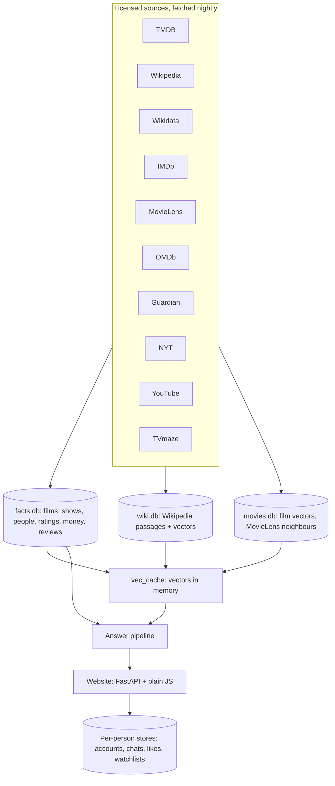

# How it works

**In one sentence:** facts come from a nightly-rebuilt database, code decides which films may be discussed, and only
then does a language model write the answer from those records.

## The toddler version

Imagine a giant library with one book for every film and show, and a librarian robot.

1. You ask a question. 2. The robot works out what you mean. 3. It runs to the shelves and grabs every book that
might match, looking several different ways. 4. It puts back every book that breaks your rules ("nothing scary",
"under two hours") and is never allowed to pick them up again. 5. It reads the books and answers, saying only what
the books say. 6. Small checkers make sure the answer names the right film and invents no numbers. Every night the
books get new pages.

## The parts

| Store | Holds | Built by |
| --- | --- | --- |
| `facts.db` | Films, shows, seasons, episodes, people, credits, keywords, age ratings, streaming services, budgets and grosses, awards, IMDb ratings, critic reviews, trailers | `fetch_tmdb.py`, `fetch_free_data.py`, `fetch_wikidata.py`, `fetch_imdb_api.py`, `v7_data.py` |
| `wiki.db` | Wikipedia lead, plot, production, reception and box-office passages, vectors, keyword index | `wiki_*.py` from the TREC Tip-of-the-Tongue 2023 corpus + live Wikipedia |
| `movies.db` | Film vectors, MovieLens neighbours (`ml_neighbours`), generated descriptions | `build_db.py`, `build_movielens.py`, `embed_movies.py` |
| `vec_cache/` | In-memory vectors for fast search | `python mb.py build-cache` |

Every source and its terms are in the licence register (`v7_data.py SOURCES`, printed in the main `README.md`).
Examples of what the terms decided: streaming data must credit JustWatch; Guardian and NYT data are for
non-commercial use; Letterboxd stays off because its terms forbid scraping.

**Identities.** A TMDB number is not unique: 1,072 numbers belong to both a film and a show. v8.1 gives every title
one id, `movie:<tmdb>` or `tv:<tmdb>`, in `media_identity`, with 125,484 outside ids (IMDb, Wikidata, TVDB) rated
`ok`, `stale`, `wrong_type` or `shared`. The audit found 519 films whose IMDb id points to a TV title; lookups do
not trust those links.

**Nightly refresh.** `nightly.sh` runs at 04:17: new and upcoming releases, streaming services, OMDb scores, new
Guardian and NYT reviews, Wikipedia reception text, TVmaze schedules, and pre-release press articles for the
forecasting research. While an evaluation runs, only steps that cannot affect it run.

## From a question to an answer

1. **Safety.** Llama Guard 3 (1B) classifies the question. Unsafe requests get a fixed refusal.
2. **Cache.** Keyed on the normalised question, the films already in the conversation, the person's taste profile
   and their limits. A "same meaning" cache reuses an answer only above a high similarity and only when no negation
   or named title differs, so "with aliens" never returns the answer to "without aliens" (tested on 20 pairs).
3. **Plan.** The chat model decides what is asked: a named title, a description, a recommendation, a follow-up, TV
   or film. For a description it also writes a guessed plot to search with (HyDE).
4. **Identity rules.** Same-name titles (*The Purge* film vs series) are routed by TV words and context. Invented
   titles get an honest "I can't find that film". Nicknames ("T2", "LOTR") expand from an alias table.
5. **Search.** Four searches run at once: vectors over TMDB records, plots, Wikipedia passages and generated
   descriptions, plus keyword search. The ranked lists are merged with reciprocal rank fusion (RRF), which needs no
   score calibration between searches.
6. **Re-rank when unsure.** If the top results are close, the model reads the top 50 films' passages and picks.
7. **Hard limits.** Saved settings and limits stated in the chat become a validated *query plan* (schema 1.1),
   compiled to parameterised SQL. A film that fails a limit cannot reach the model. Strict mode makes unknown facts
   fail (28% of shows have no episode length, so failing unknowns always would empty many lists).
8. **Answer.** A context builder assembles records, Wikipedia details, reception and (with permission) memory of
   earlier chats; the 27B persona model writes the answer, streamed to the page.
9. **Checks.** Stated numbers are compared with the records, spoiler rules apply, sources are credited.
10. **Store.** The answer is cached and the chat saved, unless the person chose a private chat.

| Model | Job | Why this one |
| --- | --- | --- |
| `movie-buff` (LoRA on Qwen 27B) | Planning and answers | Consistent persona; runs locally |
| `mxbai-embed-large` | All vectors | `mb.py check` refuses to run if the embedder differs from the one that built the vectors |
| `llama-guard3:1b` | Safety | Small and fast |
| `llama3.2` | Generated descriptions, small jobs | Cheap for bulk work |
| `gemma3:27b` | Evaluation judge only | A different model family, so the system is not graded by its own kind |

## The website

One Python server (`web/server.py`, FastAPI) and a plain-JavaScript single-page app (`web/v8/`), with no build step.
Pages: home, chat, film and show pages, Pick Tonight, Release Calendar, watchlist, profile and settings, friends.
`MOVIE_BUFF_MOCK=1` answers with a fake model and fixture data, so the whole site can be tested without a GPU;
Playwright scripts in `tools/` click through it at phone and desktop widths.

Built in v8.1 and switched off (each answers 404 until its switch is on):

| Switch | What it adds |
| --- | --- |
| `FORECAST_PANEL` | A box-office forecast panel on the film page (range first, middle estimate after, every warning) |
| `GUARDIAN_LIVE` | "In the Guardian" on the film page: stored reviews first; a live search only for films with none, about 20 a day |
| `RECS_V2` | The new ranking (`web/recs.py`) with one reason per film - only if its test passes |
| `QUERY_PLAN_SHADOW` | Logs where the query plan and an older filter path disagree |
| `TOOL_ROUTER` | Four typed tools the chat model may call: `lookup`, `search`, `recommend`, `forecast` |
| `I18N` | English and Spanish text layer (Spanish machine-written, not yet reviewed) |
