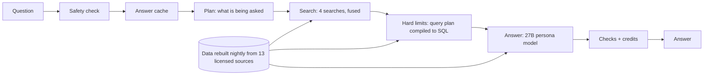

# Cinemack: the guide

Cinemack (code name *Movie Buff*) is a film and TV assistant that runs on one university server with open models. It
answers questions about films and shows, finds a film from a half-remembered description, recommends within a
person's hard limits, and forecasts box office with honest uncertainty ranges. It was built so that **every claim
about it can be checked**: each feature sits behind an off switch, the rule for keeping it is written down before
it is tested, and failures are reported next to successes.

This folder explains the whole system for someone who has never seen it. Read the files in order, or jump to what
you need.

| # | File | What it explains |
| --- | --- | --- |
| 1 | [HOW_IT_WORKS.md](HOW_IT_WORKS.md) | The architecture, the data, and the ten steps from a question to an answer |
| 2 | [RECOMMENDATIONS.md](RECOMMENDATIONS.md) | How films are ranked for a person, why a "better" ranking failed twice, and the fix being tested |
| 3 | [BOX_OFFICE.md](BOX_OFFICE.md) | The box-office forecaster: target, leak-proof inputs, conformal ranges, results |
| 4 | [EVALUATION_AND_RESULTS.md](EVALUATION_AND_RESULTS.md) | How every number was measured, and every result so far, including the failures |
| 5 | [ENGINEERING.md](ENGINEERING.md) | How changes reach the server safely, the switches, design choices and why, known limits |
| 6 | [REPRODUCE.md](REPRODUCE.md) | Rebuilding the system from scratch, step by step |
| 7 | [PUBLISHING.md](PUBLISHING.md) | What must not go into a public repository, and how to check |

## In one picture

The model only writes after code has decided which films it may talk about. That one choice explains most of the
rest of the design.

## Key numbers

- 33,041 films and 8,043 TV shows, unified into 41,084 identities (`movie:603`, `tv:1399`)
- 13+ licensed data sources, refreshed nightly; review material for 73% of all films and 100% of films with 5,000+ votes
- Hard limits (rating, length, years, genres, streaming services) match a plain-Python reference on **100%** of
  films (30 cases) and shows (24 cases)
- Box-office forecast: typical miss about 3x either way; the 80% range held 77-79% of the time on 2016-2019 films
- Sealed v8 test (12 Nov): same-name titles right 13 of 15 (v7: 11), invented films presented as real 0 of 10 (v7: 1),
  memory refer-backs 15 of 16 (v7: 12)

## Where things live

| Path | What |
| --- | --- |
| `mb.py` | One entry point: `check`, `build`, `ask`, `chat`, `serve`, `eval` |
| `retrieve.py`, `chat.py`, `tools.py`, `tv.py` | Search, prompting and answering |
| `facts_db.py`, `fetch_*.py`, `v7_data.py` | The data layer and its licence register |
| `web/` | The website (FastAPI server + plain-JavaScript pages in `web/v8/`) |
| `web/query_plan.py`, `web/plan_sql.py`, `web/plan_sql_tv.py` | Hard limits as a validated plan compiled to SQL |
| `web/recs.py`, `personal.py` | Recommendations |
| `performance.py`, `boxoffice_asof.py`, `tools/v81_forecast*.py` | Box-office forecasting |
| `web/guardian_live.py` | Guardian articles fetched when a film is opened (switched off) |
| `stage_scores.py`, `eval_v3.py`, `judge*.py` | Evaluation |
| `tools/v81_*.py` | One tool per v8.1 measurement; each writes `results/<name>.txt` and `.json` |
| `tests/` | Unit tests (`python -m unittest tests.<name>`); `tests/js/` page-module tests (`node --test`) |
| `planning/cinemack-v8.1/` | The v8.1 plan: rules written before each run (`IMPLEMENTATION_PLAN_LOCKED.md`) and results (`BASELINE_RESULTS.md`) |
| `docs/` | Decision log, issue log, design system, round notes |
